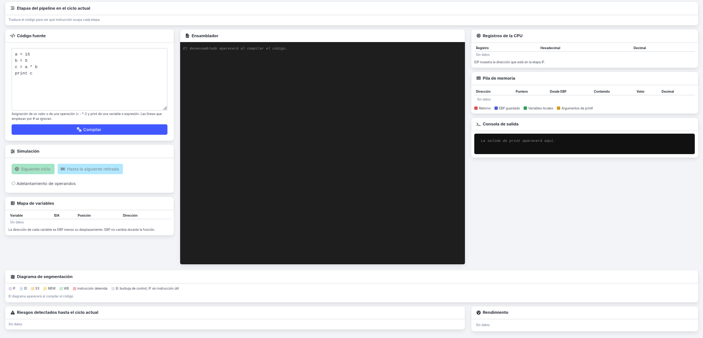
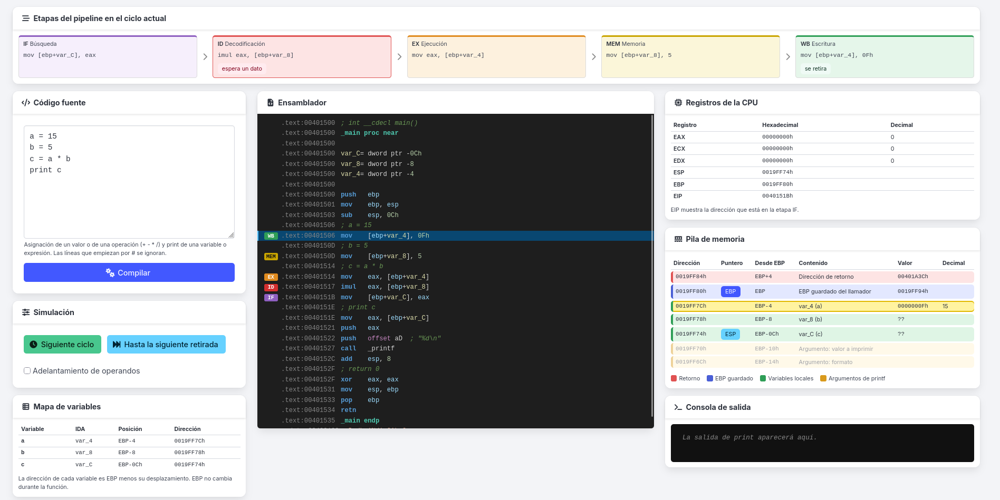
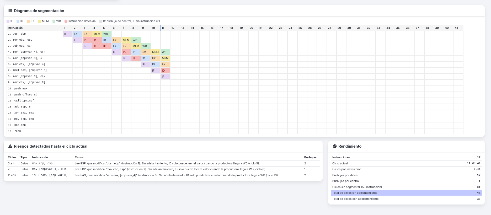
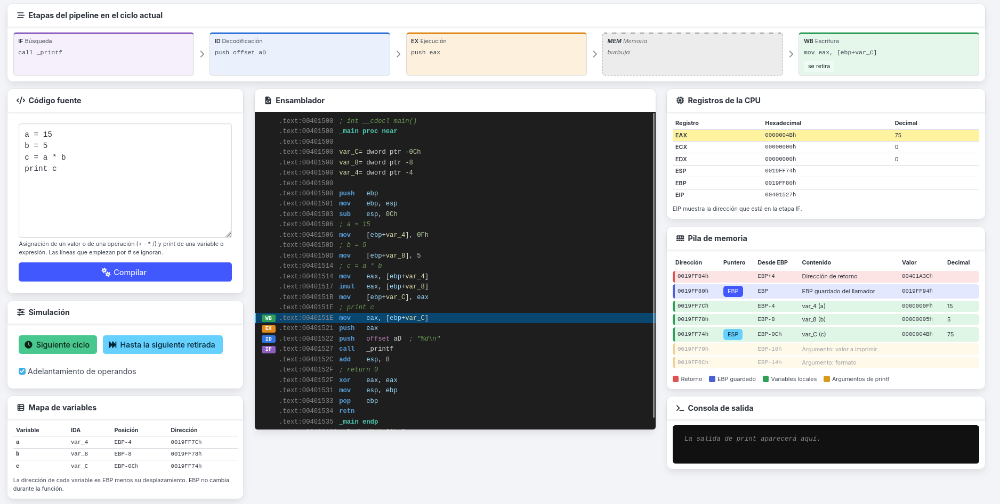
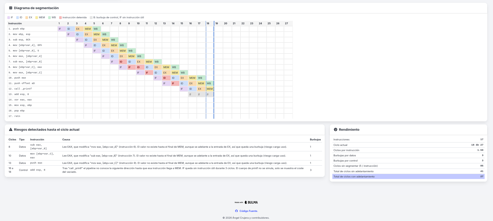

# Simulador de Pipeline x86

Desarrollado como herramienta docente para el módulo de Montaje y Mantenimiento de Equipos del Grado Medio de Informática. Su propósito es ayudar al alumnado a visualizar el funcionamiento interno de la segmentación de cauce en un procesador x86, facilitando la comprensión de conceptos abstractos como los riesgos de datos, las burbujas y el adelantamiento de operandos.

El simulador utiliza un sistema simplificado basado en un pipeline clásico de tipo RISC (con sus etapas IF, ID, EX, MEM y WB) aplicado a la ejecución de código ensamblador traducido a partir de instrucciones básicas.

## Tecnologías y Requisitos

- Backend: PHP 8.x para el procesamiento, análisis de riesgos y generación del ensamblador.
- Frontend: JavaScript nativo usando módulos ES para el navegador, sin frameworks.
- Interfaz: Bulma CSS y FontAwesome para el apartado visual.
- Servidor: Cualquier servidor HTTP compatible con PHP (Nginx, Apache o el servidor integrado de PHP).

## Lenguaje y Traducción

Consulta la documentación específica para conocer el lenguaje admitido y su traducción a ensamblador:

- [Lenguaje del simulador](./docs/lenguaje.md)
- [Traducción a ensamblador](./docs/traduccion.md)

## Estructura de Archivos

* `index.php`: Vista principal con los paneles de código, registros, pila y diagramas.
* `css/`: Estilos del proyecto modularizados, centralizados en overrides.css.
* `js/`: Lógica de la simulación en el cliente, con main.js como entrypoint.
* `includes/pipelining/`: Scripts PHP que forman el motor de traducción y cálculo del pipeline.

## Despliegue en Local

Lanzar el servidor integrado de PHP:

```bash
php -S localhost:8000

```

Abre http://localhost:8000 en el navegador.

## Preview








## Licencia

Software Libre distribuido bajo la licencia [GNU AGPLv3](./LICENSE).